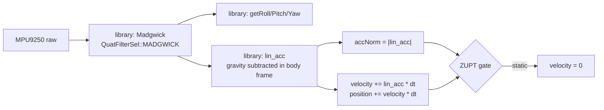

# Three generations of the IMU stack — what changed and why

This document exists so that nobody has to guess what the IMU code does today,
what it used to do, or why it was rewritten. It compares **three** generations
side by side:

| Generation | Where it lives | One-line summary |
|---|---|---|
| **Gen 1** | branch `main` | The MPU9250 library did everything: Madgwick attitude, gravity removal, calibration. ~196 lines of our own code. |
| **Gen 2** | branch `dev`, preserved in [`archive/imu-pre-px4/`](../../archive/imu-pre-px4) | We took over the pipeline: own complementary filter, own median/Butterworth/Kalman filters, own six-position calibration. ~1 691 lines. |
| **Gen 3** | current branch, [`lib/IMU/`](../../lib/IMU) | Port of PX4's IMU path: `attitude_estimator_q`, PX4 filters, PX4 calibration math, dedicated FreeRTOS task. ~3 847 lines. |

Read this together with:

* [ARCHITECTURE.md](./ARCHITECTURE.md) — how Gen 3 works today, in detail
* [PX4_PORT.md](./PX4_PORT.md) — the precise PX4 source-to-file map
* [CALIBRATION.md](./CALIBRATION.md) — how to actually run a calibration
* [ROTATION_MATRIX.md](./ROTATION_MATRIX.md) — the one thing that never changed

---

## 0. TL;DR — the five things that were actually broken

If you only read one section, read this one. These are the concrete defects
that motivated the rewrites, in the order they were discovered.

| # | Defect | Generation | Consequence |
|---|---|---|---|
| 1 | **Body-frame acceleration integrated as if it were world-frame** | Gen 1 | Position drifts wildly the moment the robot turns. `lin_acc` from the library is body-frame; integrating it directly into `position[]` is dimensionally wrong. |
| 2 | **Attitude came from a filter we could not see or tune** | Gen 1 | The library's Madgwick ran with hard-coded `beta`/`zeta` and its own `deltaT` measured from `micros()` inside the library. No bias state, no way to gate the accelerometer, no way to know if it had converged. |
| 3 | **Calibration had no quality gate and no persistence** | Gen 1 | `mpu->calibrateAccelGyro()` / `calibrateMag()` are min/max box fits. They report nothing, reject nothing, and are lost on reboot. A bad calibration was indistinguishable from a good one. |
| 4 | **Yaw was pure gyro integration** | Gen 2 | The complementary filter fused accel into roll/pitch only. Yaw had no absolute reference at all, so it drifted without bound. |
| 5 | **Sampling shared the Arduino loop** | Gen 1, Gen 2 | `dt` was whatever `millis()` happened to give. OLED refresh, servo writes and OTA all perturbed it, and the estimator integrated that jitter as real rotation. |

Gen 3 fixes all five. The rest of this document is the evidence.

---

## 1. Gen 1 — `main` (the original, non-working implementation)

### 1.1 What it was

Two files, 196 lines total:

```
lib/AHRS/AHRS.h     86 lines
lib/AHRS/AHRS.cpp  110 lines
```

There was no `lib/IMU/`, no `tools/`, no `test/`. The whole IMU story was a thin
wrapper around the `hideakitai/MPU9250@0.4.8` library.

### 1.2 The pipeline



Everything inside the dashed library box was a black box.

### 1.3 The code, verbatim

The entire `update()`:

```cpp
void AHRS::update()
{
    if (!initialized || !mpu->update())
        return;

    unsigned long now = millis();
    float dt = (now - lastUpdateTime) * 0.001f;
    lastUpdateTime = now;

    if (dt <= 0 || dt > 0.1f)
        return;

    float AccX = mpu->getAccX() * G_CONST;   // computed, then never used
    float AccY = mpu->getAccY() * G_CONST;
    float AccZ = mpu->getAccZ() * G_CONST;

    linearAccel[0] = mpu->getLinearAccX();   // <-- body frame
    linearAccel[1] = mpu->getLinearAccY();
    linearAccel[2] = mpu->getLinearAccZ();

    float accNorm = sqrt(linearAccel[0]*linearAccel[0] + ...);
    float gyroNorm = sqrt(sq(mpu->getGyroX()) + ...);

    if (accNorm < MOTION_THRESHOLD && gyroNorm < GYRO_THRESHOLD)
    {
        if (stationaryStartTime == 0)
            stationaryStartTime = now;

        if (now - stationaryStartTime > STATIONARY_TIME_MS)
        {
            isStatic = true;
            velocity[0] = velocity[1] = velocity[2] = 0;
            return;
        }
    }
    else
    {
        stationaryStartTime = 0;
        isStatic = false;
    }

    if (!isStatic)
    {
        for (int i = 0; i < 3; i++)
        {
            velocity[i] += linearAccel[i] * dt;
            position[i] += velocity[i] * dt;
        }
    }
}
```

### 1.4 Why it did not work

**Defect 1 — frame confusion.** `mpu->getLinearAccX()` returns the library's
`lin_acc[]`, which is computed as:

```cpp
lin_acc[0] = a[0] + a31;
lin_acc[1] = a[1] + a32;
lin_acc[2] = a[2] - a33;
```

where `a31`, `a32`, `a33` are rotation-matrix coefficients built from the
library's own quaternion. That subtraction happens **in the body frame**. So
`lin_acc` is body-frame linear acceleration. Integrating it straight into
`position[]` treats a rotating frame as an inertial one — the classic
"accelerate forward, turn 90°, and the robot appears to slide sideways" bug.
There was no `rotateBodyToWorld()` anywhere in Gen 1.

**Defect 2 — the attitude filter was unobservable.** `QuatFilterSel::MADGWICK`
is the library default (`QuaternionFilter.h:22`). Its gains are compile-time
constants inside the library:

```cpp
float GyroMeasError = PI * (40.0f / 180.0f);
float beta = sqrt(3.0f / 4.0f) * GyroMeasError;
```

and its `deltaT` is measured by the library itself from `micros()`, independent
of the `dt` our code computed. There was no bias state, no accelerometer gating,
and no way to ask "has it converged?".

**Defect 3 — calibration was a black box.** `calibrate()` was:

```cpp
void AHRS::calibrate()
{
    if (!initialized) return;
    mpu->calibrateAccelGyro();
    mpu->calibrateMag();
}
```

Both are min/max box fits. They return `void`. They cannot fail, cannot report a
residual, and are not persisted — every boot started from zero.

**Defect 4 — the ZUPT gate was mis-scaled.** `MOTION_THRESHOLD = 0.1 m/s²` was
applied to `|lin_acc|`, which is a noisy quantity that never sits near zero even
when the robot is still. `GYRO_THRESHOLD = 10 °/s` was far too loose. The result
was a gate that almost never fired, so the integrator ran continuously.

**Defect 5 — no telemetry contract.** `main.cpp` printed a human-readable line
every 500 ms:

```
Stat:MOV | Pos(m) X:0.123 Y:-0.045 Z:0.001 | Vel(m/s) X:... | Speed:... | LinAcc(m/s²) X:...
```

There was no CSV, no header, no column contract, and nothing for a visualizer to
parse. `tools/` did not exist on `main`.

### 1.5 What Gen 1 got right

Worth stating, because it is the reason the rotation contract survived:

* `G_CONST = 9.80665f` — correct.
* `STATIONARY_TIME_MS = 200` — the same value Gen 3 still uses.
* The `dt <= 0 || dt > 0.1f` sanity gate — Gen 3 kept this idea.
* The public getter API (`getPositionX()`, `getVelocityX()`, `isMoving()`, …) —
  unchanged in shape across all three generations, so `main.cpp` and
  `HealthCheck` never had to be rewritten.

---

## 2. Gen 2 — `dev` (the previous implementation, archived)

### 2.1 What it was

Ten files, 1 691 lines, in `lib/IMU/`. Preserved byte-for-byte in
[`archive/imu-pre-px4/`](../../archive/imu-pre-px4) — verified identical to
`git show dev:lib/IMU/*`.

| File | Lines |
|---|---|
| `AHRS.cpp` | 849 |
| `AHRS.h` | 164 |
| `ImuCalibration.cpp` | 240 |
| `ImuCalibration.h` | 37 |
| `ImuFilters.cpp` | 137 |
| `ImuFilters.h` | 57 |
| `ImuRotation.cpp` | 61 |
| `ImuRotation.h` | 23 |
| `ImuTelemetry.cpp` | 104 |
| `ImuTelemetry.h` | 19 |

Gen 2 also introduced `tools/imu_visualizer.py` and `tools/imu_visualizer_v2.py`,
and the first `docs/imu/ROTATION_MATRIX.md`.

### 2.2 The pipeline

```mermaid
graph LR
    A["MPU9250 raw"] --> B["calibration<br/>bias + diagonal scale"]
    B --> C["MedianFilter5"]
    C --> D["ButterworthFilter3<br/>accel 7.5 Hz / gyro 25 Hz"]
    D --> E["AdaptiveKalman3<br/>scalar, innovation-scaled"]
    E --> F["ComplementaryAttitude<br/>accel+gyro, Euler only"]
    F --> G["rotateBodyToWorld<br/>roll, pitch, yaw=0"]
    G --> H["gravityReference<br/>subtract world Z"]
    H --> I["deadband + planar<br/>integration"]
```



### 2.3 What Gen 2 fixed

* **Own attitude filter.** `ComplementaryAttitude` replaced the library's
  Madgwick. Accel correction was gated on `0.90 g < |a| < 1.10 g` **and**
  `|gyro| < 3 °/s`, with a first-order blend `1 - exp(-dt/0.5)`.
* **Own filters.** `MedianFilter5` → `ButterworthFilter3` (2nd order, Q = 0.707)
  → `AdaptiveKalman3` (scalar Kalman whose measurement noise grows with the
  innovation squared). Applied to accel, gyro and mag.
* **World-frame gravity removal.** `rotateBodyToWorld(roll, pitch, 0, accel,
  worldAccel)` then a slowly-adapting `gravityReference` subtracted from world Z.
  This is the fix for Gen 1's Defect 1.
* **Real still detection.** 40-sample window, three independent checks
  (accel norm ±0.02 g, gyro < 0.5 °/s, accel vector std-dev < 0.004 g), each
  reported as a bit in `still_failure_mask`.
* **Trust scheduling.** 1.0 while still, 0.0 while moving, 0.05 after 5 s of
  continuous motion — so the accelerometer never fights real acceleration.
* **Guided calibration with a quality gate.** Gyro: 2 500 samples, reject if
  σ > 0.20 °/s. Accel: six guided positions, reject if a face pair is closer
  than 0.50 g.
* **Per-robot NVS persistence.** Magic `0x494D5532`, version 4.
* **CSV telemetry.** 41 columns with a header line, so the visualizers could
  exist at all.
* **Runtime gyro bias tracking.** Clamped to ±0.5 °/s, α = 0.001, only after
  1 s of stillness.
* **Boot self-check.** Accel norm, gyro norm, mag field delta, temperature delta.

### 2.4 What Gen 2 still got wrong

**Defect 4 — yaw had no absolute reference.** This is the big one.
`ComplementaryAttitude::update()` fused the accelerometer into roll and pitch
only:

```cpp
roll  += accelTrust * correction * (accelRoll  - roll);
pitch += accelTrust * correction * (accelPitch - pitch);
// yaw is never corrected
```

Yaw was pure gyro integration. The magnetometer was read, filtered, and
telemetered — but never entered the attitude solution. Yaw drifted without
bound, and no amount of mag calibration could help because the mag was not in
the loop.

**Defect 5 — sampling shared the Arduino loop.** `ahrs.update()` was called from
`loop()`. `dt` came from `millis()`, so an OLED refresh or an OTA write directly
perturbed the integration step.

**Accel calibration was diagonal-only.** The six-position solve reduced to:

```cpp
calibration.accelBias[axis] = 0.5f * (positive[axis] + negative[axis]);
calibration.accelMatrix[axis][axis] = 2.0f / span;
```

Cross-axis coupling — real on a hand-soldered GY-91 — was structurally
unrepresentable.

**Mag calibration was still the library's.** `calibrateMagnetometer()` called
`mpu->calibrateMag()` and copied `getMagBias()` / `getMagScale()`. No residual,
no ellipsoid, no way to know if it worked.

**No estimator bias state.** The gyro bias was a constant from calibration plus
a clamped runtime tracker. There was no integral term inside the attitude loop,
so a residual bias showed up directly as attitude drift.

**No notch filter.** Only a fixed 2nd-order Butterworth.

**No host tests.** Nothing could be verified without hardware.

---

## 3. Gen 3 — current implementation

### 3.1 What it is

Thirteen files, 3 847 lines. Three of them are new:

| File | Lines | Status |
|---|---|---|
| `AHRS.cpp` | 1 286 | rewritten |
| `AHRS.h` | 283 | rewritten |
| `ImuCalibration.cpp` | 686 | rewritten |
| `ImuCalibration.h` | 127 | rewritten |
| `ImuFilters.cpp` | 350 | rewritten |
| `ImuFilters.h` | 192 | rewritten |
| `ImuRotation.cpp` | 47 | **contract preserved** |
| `ImuRotation.h` | 27 | **contract preserved** |
| `ImuTelemetry.cpp` | 100 | rewritten |
| `ImuTelemetry.h` | 32 | rewritten |
| `ImuMath.h` | 424 | **new** |
| `ImuAttitudeEstimator.cpp` | 184 | **new** |
| `ImuAttitudeEstimator.h` | 109 | **new** |

Plus `test/host/` (114 checks) and `docs/imu/`.

### 3.2 The pipeline

```mermaid
graph LR
    A["MPU9250 raw"] --> B["PX4 calibration model<br/>full 3x3 accel matrix"]
    B --> C["MedianFilter3"]
    C --> D["NotchFilter<br/>disabled by default"]
    D --> E["LowPassFilter2p<br/>gyro 40 Hz / accel 30 Hz"]
    E --> F["PX4 attitude_estimator_q<br/>quaternion + integral bias"]
    F --> G["rotateBodyToWorld<br/>frozen contract"]
    G --> H["gravityReference"]
    H --> I["still detection<br/>3-bit mask"]
    I --> J["deadband + planar<br/>integration"]
```



The whole chain runs in a **dedicated FreeRTOS task on core 1**
(`IMU_TASK_CORE 1`, priority 5, 4 KiB stack). `loop()` only copies a snapshot.

### 3.3 What Gen 3 fixed

| Gen 2 defect | Gen 3 fix |
|---|---|
| Yaw had no absolute reference | `attitude_estimator_q` fuses the magnetometer into heading, with a spin-rate gain boost above 50 °/s |
| Sampling shared the Arduino loop | Dedicated task on core 1; `dt` from `micros()`, jitter isolated from OLED/servo/OTA |
| Accel calibration diagonal-only | Full 3×3 solve: `M = (A⁻¹)ᵀ` from the six averaged faces |
| Mag calibration was the library's | LM sphere fit, then LM ellipsoid refinement, gated on residual |
| No estimator bias state | Integral gyro bias inside the estimator, frozen above 0.175 rad/s |
| No notch filter | PX4 `NotchFilter` port (static, disabled by default) |
| No host tests | 114 checks in `test/host/`, no hardware needed |
| No residual reporting | `accel_rms_g`, `mag_rms_ut`, `mag_fit`, `est_init` appended to telemetry |

### 3.4 The one thing that did **not** change

`rotateBodyToWorld()` is byte-equivalent across Gen 2 and Gen 3. Gen 1 did not
have it at all. This is deliberate — see [ROTATION_MATRIX.md](./ROTATION_MATRIX.md).
The estimator reports Euler angles in the same `Rz·Ry·Rx` convention, so the
rotation contract and the estimator agree by construction.

---

## 4. Side-by-side, subsystem by subsystem

### 4.1 Attitude / orientation

| | Gen 1 (`main`) | Gen 2 (`dev`) | Gen 3 (current) |
|---|---|---|---|
| Algorithm | Library Madgwick | Custom complementary | PX4 `attitude_estimator_q` |
| State | Library quaternion (opaque) | Euler angles only | Quaternion + integral gyro bias |
| Accel fused into | roll, pitch | roll, pitch | roll, pitch (gated 0.9–1.1 g) |
| Mag fused into | heading (inside library) | **nothing** | heading, with spin-rate boost |
| Bias state | none | none (constant + clamped tracker) | integral, frozen > 0.175 rad/s |
| Tunable | no | partially | fully, via `AttitudeEstimatorConfig` |
| Initialization | library internal | first accel sample | TRIAD from accel + mag, seeded only when `0.5 g < \|a\| < 1.5 g` |
| Yaw drift | bounded by library mag | **unbounded** | bounded by mag quality |

### 4.2 Gyroscope calibration

| | Gen 1 | Gen 2 | Gen 3 |
|---|---|---|---|
| Routine | `mpu->calibrateAccelGyro()` | own, mean + σ gate | PX4 port |
| Samples | library-defined | 2 500 (min 2 000) | 2 500 (min 2 000) |
| Settle | none | 1 500 ms | 1 500 ms |
| Quality gate | **none** | σ ≤ 0.20 °/s | σ ≤ 0.20 °/s **and** \|median − mean\| ≤ 0.6 °/s |
| Retries | none | none | 5 |
| Persistence | none | NVS, magic `0x494D5532` v4 | NVS, magic `0x494D5533` v5 |

The median/mean check is the meaningful addition: a slow drift during the run
leaves σ small but shifts the mean, and only the median comparison catches it.

### 4.3 Accelerometer calibration

| | Gen 1 | Gen 2 | Gen 3 |
|---|---|---|---|
| Routine | `mpu->calibrateAccelGyro()` | own six-position | PX4 six-position |
| Positions | library-defined | 6 guided | 6 guided, PX4 `AccelSide` order |
| Model | bias + scale | bias + **diagonal** scale | bias + **full 3×3** matrix |
| Cross-axis | no | no | yes |
| Solve | min/max box | `bias = (pos+neg)/2`, `m[i][i] = 2/span` | `offset = (pos+neg)/2`, `M = (A⁻¹)ᵀ` |
| Rejection | none | face span < 0.50 g | face span < 0.50 g |
| Residual | none | none | `accel_rms_g` |

> **Note on the transpose.** PX4 only keeps `diag(A⁻¹)`, so the transpose is
> invisible upstream. Keeping the full matrix without transposing produces a
> silently wrong correction. This was caught by the host tests — see
> [ARCHITECTURE.md](./ARCHITECTURE.md) §4.2.

### 4.4 Magnetometer calibration

| | Gen 1 | Gen 2 | Gen 3 |
|---|---|---|---|
| Routine | `mpu->calibrateMag()` | `mpu->calibrateMag()` | PX4 LM fit |
| Fit | min/max box | min/max box | sphere, then ellipsoid |
| Duration | library-defined | 15 s | 20 s |
| Min sample spacing | none | none | 3 µT |
| Min samples | none | none | 200 |
| Residual | none | none | `mag_rms_ut` |
| Fit kind reported | no | no | `mag_fit` (0/1/2) |
| Units | mG | mG | µT (`MG_TO_UT = 0.1`) |

> **Note on units.** The library returns milliGauss. PX4's LM thresholds are in
> Gauss. Using them unscaled is a ×100 error that makes every fit "succeed"
> trivially. Gen 3 converts to µT and uses 20–70 µT as the plausibility window.

### 4.5 Filtering

| | Gen 1 | Gen 2 | Gen 3 |
|---|---|---|---|
| Gyro chain | none | Median(5) → Butterworth → adaptive Kalman | Median(3) → notch → LPF2p |
| Gyro cutoff | — | 25 Hz | 40 Hz (PX4 `IMU_GYRO_CUTOFF`) |
| Accel chain | none | Median(5) → Butterworth → adaptive Kalman | LPF2p |
| Accel cutoff | — | 7.5 Hz | 30 Hz (PX4 `IMU_ACCEL_CUTOFF`) |
| Mag chain | none | Median(5) → Butterworth → adaptive Kalman | LPF2p |
| Mag cutoff | — | 5 Hz | 5 Hz |
| Notch | — | no | yes, static, **disabled by default** |
| Linear accel | — | same pipeline as accel | separate LPF2p at 7.5 Hz |
| Disabled behaviour | — | filter still runs | pass-through (PX4 semantics) |

Gen 2's adaptive Kalman is gone. It was a scalar filter whose measurement noise
grew with the innovation squared — which is a heuristic, not a model, and it
made the filter's phase response depend on signal amplitude. PX4's fixed
Butterworth has a known, constant phase lag, which matters because the
estimator's `dt` compensation assumes it.

### 4.6 Frames and gravity removal

| | Gen 1 | Gen 2 | Gen 3 |
|---|---|---|---|
| Body frame | library internal | FLU | FLU |
| World frame | none | ENU-like | N-W-U |
| `rotateBodyToWorld` | **absent** | present | present, **byte-identical** |
| Gravity removal | library, body frame | world Z − `gravityReference` | world Z − `gravityReference` |
| `gravityReference` update | — | α = 0.02 while static | α = 0.02 while static |
| Yaw used in rotation | — | **0** (deliberate) | **0** (deliberate) |

Yaw is passed as 0 to `rotateBodyToWorld` in both Gen 2 and Gen 3. That is not a
bug: gravity is vertical, so the yaw component of the rotation cannot change the
world Z component. Passing 0 avoids injecting yaw noise into the gravity
estimate.

### 4.7 Still detection and ZUPT

| | Gen 1 | Gen 2 | Gen 3 |
|---|---|---|---|
| Window | none | 40 samples | 40 samples |
| Accel norm check | `\|lin_acc\| < 0.1 m/s²` | `\|\|a\| − 1 g\| < 0.02 g` | same |
| Gyro check | `< 10 °/s` | `< 0.5 °/s` | same |
| Std-dev check | none | `< 0.004 g` | same |
| Failure reporting | none | 3-bit mask | 3-bit mask |
| Time to declare static | 200 ms | 200 ms | 200 ms |
| Trust schedule | none | 1.0 / 0.0 / 0.05 | same |

Gen 1's gate was effectively dead (see Defect 4). Gen 2's is the one that
survived, and Gen 3 kept it unchanged — it works.

### 4.8 Dead reckoning

| | Gen 1 | Gen 2 | Gen 3 |
|---|---|---|---|
| Integration | body-frame accel | world-frame accel | world-frame accel |
| Deadband | none | mode 2, 0.01 m/s² | same |
| Planar mode | no | yes (compile-time) | same |
| ZUPT | zero velocity | zero velocity | same |
| Position reset on ZUPT | **no** | no | no |
| Filtered vs raw for integration | raw | raw (filtered only for telemetry) | same |

### 4.9 Scheduling

| | Gen 1 | Gen 2 | Gen 3 |
|---|---|---|---|
| Where it runs | `loop()` | `loop()` | dedicated task, core 1 |
| `dt` source | `millis()` | `millis()` | `micros()` |
| Priority | — | — | 5 |
| Stack | — | — | 4 096 B |
| OTA interaction | starves the estimator | starves the estimator | isolated; task pauses with a handshake |
| Snapshot handoff | none (direct member reads) | none (direct member reads) | double-buffered, race-free |

Gen 1 and Gen 2 both had data races: `loop()` read `velocity[]` / `position[]`
while `update()` wrote them. Gen 3 publishes an immutable `ImuTelemetry`
snapshot.

### 4.10 Telemetry

| | Gen 1 | Gen 2 | Gen 3 |
|---|---|---|---|
| Format | human-readable text | CSV | CSV |
| Columns | — | 41 | 51 |
| Header | no | once at boot | at boot **and every 5 s** |
| Write strategy | 34 `Serial.print` calls | 53 `Serial.print` calls | one `snprintf` + one `Serial.write` |
| Interval | 500 ms | 100 ms | 100 ms |
| New columns | — | — | `ebx/eby/ebz`, `acc_norm_g`, `mag_norm`, `rate_hz`, `accel_rms_g`, `mag_rms_ut`, `mag_fit`, `est_init` |
| Visualizer support | none | v1 + v2 | v1 + v2, both tolerant of extra columns |

The 10 appended columns are strictly additive — Gen 2's 41 columns keep their
positions, so an old visualizer still parses a Gen 3 line.

### 4.11 Persistence

| | Gen 1 | Gen 2 | Gen 3 |
|---|---|---|---|
| Storage | none | `Preferences` | `Preferences` |
| Per robot | — | yes | yes |
| Magic | — | `0x494D5532` | `0x494D5533` |
| Version | — | 4 | 5 |
| Fields | — | bias, scale, matrix, temp, field norm | + `accelFitRms`, `magFitRms`, `accelSides`, `magFitKind` |
| Migration | — | — | version bump forces recalibration (no silent reuse) |

### 4.12 Testing

| | Gen 1 | Gen 2 | Gen 3 |
|---|---|---|---|
| Host tests | none | none | 114 checks, `test/host/run.sh` |
| Rotation contract pinned | no | no | yes |
| Estimator init pinned | no | no | yes |
| Calibration round-trip | no | no | yes |
| End-to-end yaw tracking | no | no | yes |

---

## 5. Current implementation vs PX4

This is the summary; [PX4_PORT.md](./PX4_PORT.md) has the file-by-file map.

### 5.1 Same as PX4

* `attitude_estimator_q` update equations, including the mag spin-rate gain
  boost and the accel norm gate.
* `LowPassFilter2p`, `NotchFilter`, `MedianFilter`, `AlphaFilter` coefficient
  math and reset seeding.
* Six-position accelerometer solve.
* LM sphere → ellipsoid magnetometer fit, including the "seed the ellipsoid from
  the sphere" ordering.
* Gyro calibration sample count, σ gate, and median/mean consistency check.
* Default cutoffs: accel 30 Hz, gyro 40 Hz, notch bandwidth 20 Hz.

### 5.2 Deliberately different

| Item | PX4 | Here | Why |
|---|---|---|---|
| Body / world frame | FRD / NED | FLU / N-W-U | Project convention; the rotation contract is frozen |
| `ATT_W_GYRO_BIAS` | 0.1 | 0.02 | 0.1 is under-damped for a robot that sits still for minutes |
| `ATT_BIAS_MAX` | 0.05 rad/s | 0.15 rad/s | GY-91 residual bias after a short calibration |
| Accel matrix | diagonal only | full 3×3 | Hand-soldered GY-91 has real cross-axis terms |
| Mag units | Gauss | µT | Project convention; LM thresholds scaled ×100 |
| Mag fit seeding | previous calibration | sample centroid + mean distance | No previous calibration on first run |
| Mag radius window | 0.2–0.7 G | 20–70 µT | Same physical window, different units |
| Notch | dynamic bank (ESC RPM / FFT) | single static notch, disabled | No RPM telemetry, no FFT budget |
| Thermal calibration | full offset model | boot-time drift *detection* only | Out of scope; detection forces recalibration |
| Gyro bias | estimator only | estimator **and** clamped runtime tracker | Handles slow drift between calibrations |
| Scheduling | `WorkItem` on a dedicated thread | FreeRTOS task on core 1 | No `WorkItem`/`ModuleBase` here |

### 5.3 Not ported

No matching input exists on this robot:

* GPS velocity fusion (`ATT_ACC_COMP`)
* Vision odometry heading (`ATT_EXT_HDG_M = 1`)
* Motion-capture heading (`ATT_EXT_HDG_M = 2`)
* GPS-derived magnetic declination (`ATT_MAG_DECL_A`)
* uORB, `ModuleBase`, `WorkItem`, the parameter framework
* The `matrix` library (replaced by `ImuMath.h`)
* `sensor_correction` thermal offsets
* Factory calibration storage

---

## 6. Decision log — why each change was made

| Decision | Alternative considered | Why |
|---|---|---|
| Port PX4's estimator | Keep Gen 2's complementary filter | Gen 2's had no mag in the loop, so yaw was unbounded. Writing a new EKF was more risk than porting a known-good one. |
| Keep `rotateBodyToWorld` verbatim | Use the estimator quaternion directly | It is the validated contract. Changing it would silently change what every plot means. |
| Full 3×3 accel matrix | PX4's diagonal-only | The GY-91 is hand-soldered; cross-axis terms are real. Costs 6 floats and one 3×3 multiply. |
| LM sphere + ellipsoid mag fit | Keep the library's `calibrateMag()` | The library's is a min/max box fit with no residual and no refinement. |
| Dedicated task on core 1 | Keep running in `loop()` | Stable `dt`; OTA and OLED cannot starve the estimator. |
| `gyroBiasWeight = 0.02` | PX4's 0.1 | 0.1 is under-damped for a stationary robot — the estimate overshoots and takes ~1 min to settle. |
| Notch disabled by default | Enable at a fixed frequency | A crawler has no dominant vibration line; a mis-tuned notch only adds phase lag. |
| Append-only CSV | Reorder / rename columns | Keeps both visualizers working across firmware revisions. |
| `Preferences` blob per robot | One global blob | Eight robots share the firmware; each needs its own calibration. |
| Drop the adaptive Kalman | Keep it alongside the Butterworth | Its phase response depends on signal amplitude, which breaks the estimator's `dt` assumptions. |
| Version bump to 5 | Reuse version 4 records | The record layout changed; silently reusing old blobs would apply a diagonal matrix as if it were full. |

---

## 7. What to watch after the rewrite

These are the places where Gen 3 behaves differently in a way you can observe:

1. **Yaw now moves when you rotate the robot near metal.** That is the
   magnetometer working. In Gen 2 yaw only moved with the gyro.
2. **`est_init` may stay 0 for a second or two at boot.** The estimator waits
   for a plausible gravity vector before seeding. This is intentional.
3. **`rate_hz` should read close to 200.** If it reads much lower, something is
   starving the IMU task — check `IMU_TASK_CORE` and the OTA path.
4. **`accel_rms_g` above ~0.02 g means a bad accel calibration.** Redo it.
5. **`mag_rms_ut` above ~2 µT means a bad mag calibration.** Redo it away from
   metal.
6. **`ebx/eby/ebz` should sit near zero and stay flat.** A slow ramp means the
   calibration left bias behind.
7. **The heading dial reads `(270 − yaw) mod 360`.** See
   [ARCHITECTURE.md](./ARCHITECTURE.md) §2 — the IMU is mounted with body +X
   pointing right, so the firmware's yaw tracks the robot's right-hand side.

---

## 8. How to tell which generation you are running

```bash
# Gen 1 — no lib/IMU at all
git ls-tree --name-only main:lib/          # shows AHRS, Display, HealthCheck, ...

# Gen 2 — lib/IMU exists, no estimator, no ImuMath.h
git ls-tree --name-only dev:lib/IMU/       # no ImuAttitudeEstimator, no ImuMath.h

# Gen 3 — current
ls lib/IMU/                                # ImuMath.h + ImuAttitudeEstimator.* present
```

At runtime, the fastest tell is the telemetry header:

| Generation | Header starts with | Column count |
|---|---|---|
| Gen 1 | *(no CSV at all)* | — |
| Gen 2 | `IMU,t_ms,dt,ax,...` | 41 |
| Gen 3 | `IMU,t_ms,dt,ax,...` | 51 (ends with `est_init`) |

If the last column is `pitchG`, you are on Gen 2. If it is `est_init`, you are
on Gen 3.

---

## 9. Rollback

Gen 2 is preserved verbatim. To go back:

```bash
# restore the whole previous implementation
cp archive/imu-pre-px4/* lib/IMU/

# or take it from the branch
git checkout dev -- lib/IMU/
```

Two things to remember if you do:

* `include/config.h` on Gen 3 defines `IMU_TASK_CORE` / `IMU_TASK_PRIORITY` /
  `IMU_TASK_STACK`. Gen 2 ignores them, so leaving them in place is harmless.
* `src/main.cpp` on Gen 3 calls `ahrs.startTask()`. Gen 2 has no such method —
  revert `src/main.cpp` too, or the build will fail.

The visualizers are forward-compatible: they parse both the 41-column and
51-column formats, so they do not need to be reverted.

---

## 10. File inventory per generation

### Gen 1 — `main`

```
lib/AHRS/AHRS.h          86
lib/AHRS/AHRS.cpp       110
                        ---
                        196
```

No `lib/IMU/`, no `tools/`, no `test/host/`, no `docs/imu/`.

### Gen 2 — `dev` / `archive/imu-pre-px4`

```
lib/IMU/AHRS.h                  164
lib/IMU/AHRS.cpp                849
lib/IMU/ImuCalibration.h         37
lib/IMU/ImuCalibration.cpp      240
lib/IMU/ImuFilters.h             57
lib/IMU/ImuFilters.cpp          137
lib/IMU/ImuRotation.h            23
lib/IMU/ImuRotation.cpp          61
lib/IMU/ImuTelemetry.h           19
lib/IMU/ImuTelemetry.cpp        104
                               ----
                               1691

tools/imu_visualizer.py
tools/imu_visualizer_v2.py
docs/imu/ROTATION_MATRIX.md
docs/IMU_COMPARISON_PX4_BETAFLIGHT.fa.md
docs/IMU_DEBUGGING.fa.md
docs/IMU_GUIDE.fa.md
docs/IMU_STATUS_TEMP.fa.md
```

### Gen 3 — current

```
lib/IMU/ImuMath.h                    424   new
lib/IMU/ImuAttitudeEstimator.h       109   new
lib/IMU/ImuAttitudeEstimator.cpp     184   new
lib/IMU/ImuFilters.h                 192
lib/IMU/ImuFilters.cpp               350
lib/IMU/ImuCalibration.h             127
lib/IMU/ImuCalibration.cpp           686
lib/IMU/ImuRotation.h                 27
lib/IMU/ImuRotation.cpp               47
lib/IMU/AHRS.h                       283
lib/IMU/AHRS.cpp                    1286
lib/IMU/ImuTelemetry.h                32
lib/IMU/ImuTelemetry.cpp             100
                                    ----
                                    3847

test/host/test_imu_math.cpp
test/host/run.sh
test/host/README.md
docs/imu/ARCHITECTURE.md
docs/imu/CALIBRATION.md
docs/imu/PX4_PORT.md
docs/imu/ROTATION_MATRIX.md
docs/imu/IMPLEMENTATION_HISTORY.md   (this file)
docs/imu/README.md
archive/imu-pre-px4/                 (Gen 2, verbatim)
```

---

## 11. Adjacent changes that are *not* IMU

The rewrite touched a few files outside `lib/IMU/`. They are listed here so that
a diff against `dev` is not surprising, and so nobody mistakes them for IMU
changes:

| File | Change | Why |
|---|---|---|
| `include/config.h` | added `IMU_TASK_CORE`, `IMU_TASK_PRIORITY`, `IMU_TASK_STACK` | the dedicated task needs a core, priority and stack size |
| `src/main.cpp` | calls `ahrs.startTask()` after calibration | the sampling loop no longer runs in `loop()` |
| `lib/HealthCheck/HealthCheck.*` | `run()` now returns a `HealthReport`; added servo motion checks | **servo** work, unrelated to the IMU rewrite — it landed in the same branch |
| `lib/ServoControl/ServoControl.*` | servo health integration | same, servo work |
| `lib/ServoControl/ServoHealth.h` | new | same, servo work |
| `docs/SERVO_HEALTH.md` | new | same, servo work |
| `.gitignore` | ignore `__pycache__/` and `*.pyc` | a tracked `.pyc` was removed from the index |

The servo changes are documented separately in
[`docs/SERVO_HEALTH.md`](../SERVO_HEALTH.md). Nothing in them affects the IMU
signal chain.

---

## 12. Verification status

| Check | Command | Result |
|---|---|---|
| Host math tests | `test/host/run.sh` | 114 checks, 0 failures |
| Firmware build | `pio run -e esp32-s3-devkitm-1` | SUCCESS, no warnings |
| RAM | — | 20.1 % (65 984 / 327 680 B) |
| Flash | — | 24.9 % (833 897 / 3 342 336 B) |
| Gen 2 archive fidelity | `diff` against `git show dev:lib/IMU/*` | identical, all 10 files |
| Visualizer compatibility | both scripts against 41- and 51-column lines | parses both |
